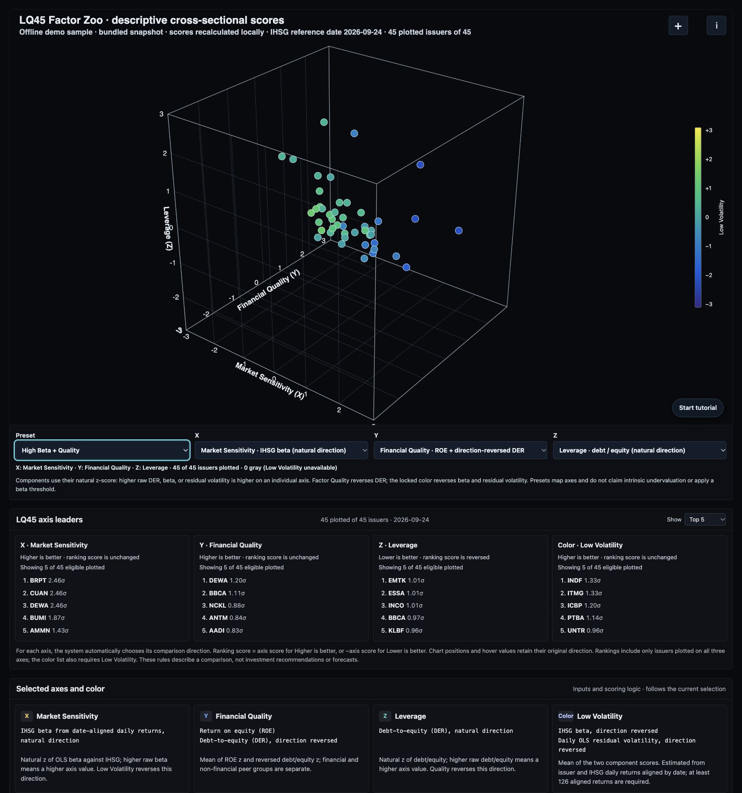

# LQ45 Factor Zoo

A focused, standalone reproduction of the **LQ45 Factor Zoo 3D scatter plot** from [IDX Evidence Lab](https://github.com/rasyaaudreabramantyawijaya/IDX-Evidence-Lab). The project keeps the original visualization's four factor characteristics, point-level evidence, and factor leaderboards in one view. It does not reproduce the Evidence Lab dashboard or other workspaces.

> **Snapshot and interpretation:** this demo reads a compact local snapshot with an IHSG reference date of **2026-09-24** and company-report data dated **2026-09-25**. It does not fetch or refresh market data. Factor scores are relative, descriptive characteristics for the included current-universe snapshot; they are not forecasts, return probabilities, investment recommendations, or evidence of factor performance.



The preview shows the High Beta + Quality preset using the bundled historical demo snapshot. The image is static; use the local application for interactive controls.

[Open the interactive demo](https://rasyaaudreabramantyawijaya.github.io/LQ45-Factor-Zoo/)

## What the visualization shows

Each plotted point represents one LQ45 issuer. Its 3D position and color encode four cross-sectional factor scores:

- **X — Value:** earnings yield and dividend yield. Higher component values contribute to a higher relative Value score.
- **Y — Momentum:** 12–1-month price return and price relative to the 200-session simple moving average.
- **Z — Quality:** return on equity and inverse debt-to-equity. Financial and non-financial issuers use separate Quality peer groups.
- **Color — Low Volatility:** inverse IHSG beta and inverse residual volatility. The MATLAB-style Parula scale maps higher relative scores toward yellow and lower scores toward purple.

The page opens directly on the 3D visualization with a bundled demo snapshot. Drag the plot to rotate it, scroll to zoom, and hover over a point to reveal its ticker, sector, selected axis scores and underlying inputs, component z-scores, eligible peer counts, reference dates, price coverage, and subsector. The wide hover panel lays out issuer metadata and selected axis details side by side on desktop, then stacks them on narrow screens. It also shows how scores are composed, including the direction reversal for debt-to-equity, beta, and residual volatility. A point crosshair projects the selected issuer onto the axes. Use the arrow keys while the chart is focused to rotate the camera; reload the page to restore its initial view. The leaderboards and explanation cards below the plot follow the selected axes and the active dataset.

### Factor inputs at a glance

- **Value (X):** verified positive forward P/E is inverted to earnings yield; dividend yield is the trailing 12-month yield. Both are sourced from the company-report snapshot.
- **Momentum (Y):** 12–1 return is `close[t−21] / close[t−252] − 1`; the second component is `close[t] / SMA200[t] − 1`, where SMA200 is the mean of the latest 200 daily closes.
- **Quality (Z):** ROE and debt-to-equity (DER) come from company-report ratios. DER is direction-reversed, and both components are standardized separately for financial and non-financial peers.
- **Low Volatility (color):** IHSG beta and the population standard deviation of OLS residual daily returns are estimated from issuer/IHSG returns aligned by date. Both components are direction-reversed; at least 126 aligned returns are required.

For every issuer, hover details expose the underlying component values, z-scores, eligible peer counts, factor scores, report as-of date, price range, and IHSG reference date. A factor with incomplete component coverage is marked `PARTIAL`; unavailable components are not imputed as zero. Factor values describe relative positions in this snapshot and do not establish that a characteristic predicts returns.

## Scoring method

The plot reproduces the Factor Zoo's descriptive, cross-sectional scoring method:

1. Score each available component across its eligible peer set. At least five valid peers are required. Value, Momentum, and Low Volatility use eligible issuers in the snapshot; Quality is standardized separately within the financial and non-financial peer groups.
2. Winsorize component values at the 5th and 95th percentiles.
3. Calculate a population z-score and clip it to the range −3 to +3. Reverse the direction for debt-to-equity, beta, and residual volatility so that lower values receive higher relative scores.
4. Combine available component scores using their arithmetic mean. The compact data dump includes every component's raw value, standardized z-score, and eligible peer count, so each displayed factor score can be recomposed and checked. A factor is `AVAILABLE` only when all of its components are available; otherwise it is `PARTIAL` or `UNAVAILABLE`.

Momentum uses the 12–1 return (`close[t−21] / close[t−252] − 1`) and the latest close relative to the simple moving average of the latest 200 closes. Beta and residual volatility are estimated from issuer returns aligned to IHSG returns; at least 126 aligned daily returns are required. Quality component scores are standardized separately within financial and non-financial peer groups.

## Demo data and provenance

[`data/demo-universe.json`](data/demo-universe.json) is a reduced export of the locally available Factor Zoo snapshot for **45 LQ45 issuers in that snapshot**. It retains issuer names, factor scores, each factor component's raw input, component z-score and eligible peer count, component/factor availability, peer group, reference dates, and daily-coverage metadata required for this visualization. It omits raw daily OHLCV histories, company-report files, and source filesystem paths. [`data/demo-factor-inputs.csv`](data/demo-factor-inputs.csv) contains the corresponding source-derived raw factor-component inputs. On page load the browser reads that CSV and **recalculates the cross-sectional component z-scores, factor scores, plot positions, and leaderboards**; the page does not merely draw the stored score values. The default axes show **35 plotted issuers** with all three scores available; a different axis selection can change the number of plotted issuers.

The source artifact marks its universe metadata `PARTIAL` because the universe snapshot hash is missing or mismatched. Coverage also varies by issuer and factor. This demo uses current snapshot membership; it does not reconstruct historical IDX/LQ45 membership, delisted issuers, or point-in-time constituent changes. Missing factor inputs remain missing and are never replaced with zero.

The reduced export was derived from local source artifact fingerprint `007f24fe3c254a7080a2d26b540a163f6b685ae2b02d761ecd4ed636910940af`. The source project remains separate and unchanged. Relevant source implementation and artifact:

- [`portfolio_factors.py`](https://github.com/rasyaaudreabramantyawijaya/IDX-Evidence-Lab/blob/main/src/idx_evidence_lab/portfolio/portfolio_factors.py) — factor inputs, cross-sectional scoring, and coverage rules.
- [`130-portfolio-lab-factor-zoo.js`](https://github.com/rasyaaudreabramantyawijaya/IDX-Evidence-Lab/blob/main/frontend/legacy/scripts/130-portfolio-lab-factor-zoo.js) — source visualization behavior.
- [`portfolio-factor-zoo-data.json`](https://github.com/rasyaaudreabramantyawijaya/IDX-Evidence-Lab/blob/main/docs/prototypes/portfolio-factor-zoo-data.json) — source data artifact.

## Import data and recalculate locally

Use the **+** button in the chart’s upper-right corner to open the operating system’s file chooser (Finder on macOS, File Explorer on Windows, or the browser’s file picker on Linux and other systems). The adjacent **i** button explains the accepted data and links to the template ZIP. You can also drop CSV or ZIP files directly onto the 3D chart; there is no separate drop zone. Select several CSVs together or one ZIP containing the CSVs. The browser parses and calculates locally; file contents are not uploaded. A cloned checkout includes a bundled demo snapshot and an embedded startup fallback, so the initial visualization still appears when the page is opened directly from `index.html` and browser `fetch()` cannot read local files.

Two input shapes are supported:

1. **Factor-input CSV:** one row per issuer, with raw component columns such as `earnings_yield`, `dividend_yield`, `momentum_12_1`, `price_vs_ma200`, `roe`, `debt_to_equity`, `beta_ihsg`, and `residual_volatility`. The browser recalculates peer standardization, factor scores, plot classification, and leaderboards from those values. It does not require precomputed z-scores.
2. **Raw-data CSVs:** `prices.csv` with `ticker,date,close`; `ihsg.csv` with `date,close`; and `fundamentals.csv` with `ticker,report_as_of,forward_pe,dividend_yield_ttm,roe,debt_to_equity`. Select the files together or put them in a ZIP. For issuer prices, separate CSVs named for each ticker (for example `BBCA.csv`) may omit the ticker column. Daily OHLCV inputs are fine, but this version uses the close column only; volume and open/high/low are not used in its current factors. At least 253 issuer closes are needed for 12–1 return and SMA200, and at least 126 date-aligned daily returns for IHSG beta and residual volatility. The app inverts only positive forward P/E to calculate earnings yield. For Value and Quality, provide ratios transcribed or calculated from company reports; this tool does not extract figures from full financial-statement files or PDFs. Fundamental fields with later report dates replace earlier rows for the same issuer. The report ratios are inputs, not a substitute for historical point-in-time financial statements; the app does not reconstruct when each historical filing became public.

Download the header-only [CSV template ZIP](data/factor-zoo-input-template.zip). It contains templates for factor inputs, prices, IHSG, and fundamentals. Required calculation windows are enforced: at least **253 issuer closes** for 12–1 momentum and SMA200, at least **126 consecutive date-aligned daily returns** for beta/residual volatility, and at least **five eligible peers** for a cross-sectional z-score. Files with insufficient coverage produce partial or unavailable factors instead of fabricated values. Quality is standardized within the supplied financial/non-financial peer groups; if no peer group is supplied, the app infers financial issuers from sector text and leaves missing sector classifications unclassified, so review the resulting peer groups.

Use decimal values for returns, yields, ROE, and volatility (for example, `0.05` means 5%). A value explicitly marked with a `%` sign or a `_pct` column header is converted from percentage points. P/E and debt-to-equity are plain ratios. The raw-price path uses the submitted `close` series as provided; corporate actions and adjusted-price correctness are not inferred. Give the IHSG benchmark file an `ihsg` or `index` filename, or use `IHSG` in its ticker column. Encrypted ZIP files and non-CSV archive members are ignored/rejected; ZIPs must use Store or Deflate compression. Imports are limited to 20 files, 50 MB per CSV, 25 MB per ZIP, and 100 MB total expanded data. Imports are temporary in the browser and are not written back into the repository.

The bundled inputs are actual reduced component values from the local Evidence Lab artifact, not hand-made issuer scores. This standalone reproduction retains the source formulas and scoring behavior, but it is not a full clone of the Evidence Lab app or its ingestion backend. The bundled CSV contains derived factor inputs rather than full issuer OHLCV/report archives; raw OHLCV and fundamentals are required if you want the browser to derive every underlying component from your own files. The bundled historical price coverage is limited and should not be described as a 10-year dataset.

## Choose the 3D axes

Use the **Preset** and **X**, **Y**, **Z** selectors on the chart to change its three axes. Axis headings describe the analytical concept, such as **Profitability** for ROE, **Leverage** for debt-to-equity, or **Market Sensitivity** for IHSG beta; the selector and hover details identify the underlying component. The color is locked to **Low Volatility**. Selecting a preset changes the axes; selecting a factor or component manually changes that axis and switches to Custom.

- **Original factor map:** X = Value, Y = Momentum, Z = Quality.
- **Relative Value:** X = earnings yield, Y = dividend yield, Z = Quality. The first two axes show separate components of relative valuation; Quality adds context. This is not an intrinsic-value calculation.
- **High Beta + Quality:** X = IHSG beta, Y = Quality, Z = debt-to-equity. The preset changes the axes; it does not filter for beta above one or prove future financial performance.
- **Custom axes:** choose any of the three existing factor scores or eight available component z-scores independently for each axis. No additional data is fetched.

Each point needs the three selected axis values; unrelated missing inputs do not exclude it. A point with an unavailable Low Volatility color is gray. Individual indicator axes use the **natural** z-score direction, so higher raw DER, beta, or residual volatility is higher on that axis. The Quality factor and Low Volatility color retain their established reversed directions. The three axis leaderboards, their definitions, and the hover details follow the current selections. Leaderboards rank only issuers plotted on the current axes; the Low Volatility leaderboard additionally requires a complete color score. A higher individual-axis score means a higher value, not necessarily a better outcome. These views describe the supplied sample and do not generate buy/sell signals or evaluate predictive performance.

### Ranking direction and list length

The leaderboard can show the top 5, 10, 15, or all eligible plotted issuers. Each X/Y/Z card shows the automatically assigned direction for its selected indicator. The ranking score equals the displayed axis score when higher is favored, or the negative of that score when lower is favored; the lists are ordered by ranking score, highest first. The chart and point tooltip continue to show the original inputs and axis scores. The Low Volatility color score retains its original direction and is ranked from high to low.

The individual debt-to-equity and residual-volatility axes favor lower values; the other available indicators and already oriented composite factors favor higher scores. These are predefined comparison conventions, not proof of investment quality. The High Beta + Quality preset favors higher beta to match its stated research view; high or low beta alone does not determine desirability or overall risk. DER can also be misleading, especially when equity is negative or when comparing industries. Issuers missing any selected X/Y/Z score cannot appear in the plot or its rankings; issuers without a Low Volatility score are excluded from the color ranking.

The **Start tutorial** button opens a guided tour of data import, input requirements, presets, custom axes, point details, rankings, and scoring. Use Back and Next to move manually, or turn on automatic advance. The tour demonstrates the interface without importing a file.

## Research notebook

[`notebooks/lq45_factor_zoo_research.ipynb`](notebooks/lq45_factor_zoo_research.ipynb) is a visible, step-by-step research notebook for inspecting data quality, deriving the four factor families, reproducing cross-sectional scores, and exploring the results. Its sections move from the research question and data source audit through feature engineering, scoring, the interactive 3D map, live leaderboards, descriptive diagnostics, and limitations. The notebook recalculates from its selected input; it does not train a predictive model or claim strategy performance.

The default `website_demo` mode reads the same locally bundled component CSV as the website: 45 issuers, with 35 complete three-axis points in the current snapshot. It recalculates scores from the stored component values; it does not recompute price features or OLS from raw histories in this mode. The IHSG reference date is 2026-09-24 and the report snapshot is dated 2026-09-25.

The separate offline ZIP at [`data/examples/yfinance-idx-10y-import.zip`](data/examples/yfinance-idx-10y-import.zip) contains daily price history from **2016-10-31 to 2026-10-30** for ten IDX issuers and IHSG (`^JKSE`), plus a latest-fundamentals snapshot. Select `bundled_zip` to rebuild components from these raw files. This example is not the complete IDX universe, historical LQ45 membership, or point-in-time fundamentals. Its prices use Yahoo's adjusted daily close; `Adj Close` takes precedence over `Close` when both exist. Neither bundled mode makes a market-data request.

### Notebook input choices

At the top of the notebook, set `DATA_MODE` to one of these options:

- `website_demo` — recalculate the website's source-derived component snapshot without network access.
- `bundled_zip` — run the included ten-issuer raw-data sample without network access.
- `custom_zip` — read a ZIP containing `prices.csv`, `ihsg.csv`, and `fundamentals.csv`.
- `custom_csv_dir` — read those three CSV files from a local folder.
- `factor_input_csv` — score one row per issuer from raw component inputs; the notebook computes peer standardization and factor scores itself, so precomputed z-scores are not required.

For raw-price input, use issuer `ticker,date,close` rows, benchmark `date,close` rows, and company-report rows with `ticker,report_as_of,forward_pe,dividend_yield_ttm,roe,debt_to_equity` and, when available, `sector` or `peer_group`. Yahoo-style `Adj Close` is also accepted. OHLCV `Open`, `High`, `Low`, and `Volume` are not used by these four factors. Value and Quality need report-derived ratios; the notebook does not parse financial statements or PDFs. Company-report fields in the bundled Yahoo sample are snapshots, not historical point-in-time observations.

For direct factor input, provide these raw columns where available: `earnings_yield`, `dividend_yield`, `momentum_12_1`, `price_vs_ma200`, `roe`, `debt_to_equity`, `beta_ihsg`, and `idiosyncratic_volatility`. `ticker` is required; `company`, `sector`, `peer_group`, `as_of`, and `report_as_of` are optional metadata. Equivalent aliases and `_pct` headers are supported. Values with a `%` sign or `_pct` header are converted to decimals; otherwise use decimal units for returns, yields, ROE, and volatility. Missing fields remain unavailable rather than being filled with zero.

The notebook includes commented setup examples for Google Colab file upload and Drive, Kaggle datasets, and local macOS/Linux/Windows paths. To run locally, install only the notebook dependencies and open it from the repository root:

```bash
python3 -m pip install -r requirements-notebook.txt
python3 -m jupyter lab notebooks/lq45_factor_zoo_research.ipynb
```

On Windows PowerShell:

```powershell
py -3 -m venv .venv
.\.venv\Scripts\python.exe -m pip install -r requirements-notebook.txt
.\.venv\Scripts\python.exe -m jupyter lab notebooks/lq45_factor_zoo_research.ipynb
```

The interactive 3D chart uses Plotly in a compatible notebook viewer. A static 3D preview and factor leaderboard charts are saved in the notebook for viewers that cannot render interactive JavaScript, including GitHub's rendered notebook view. To export a self-contained interactive HTML chart, set `FACTOR_ZOO_EXPORT_3D_HTML` to a writable local filename before starting Jupyter; the file contains the plotted input data.

The notebook's axis cell supports `default`, `relative_value`, `high_beta_quality`, and a user-edited `CUSTOM_AXES` mapping. Change `AXIS_PRESET` or set `FACTOR_ZOO_AXIS_PRESET` before starting Jupyter, then execute the axis and 3D cells. In a compatible interactive Plotly viewer, the chart's three dropdowns can also change the axes without rerunning the calculation. The notebook leaderboard uses the axes selected in Python, their automatic ranking directions, and a configurable list length; the Plotly dropdowns change only the chart, so rerun the relevant cells after changing Python settings to update its tables. Axis choices, component directions, and the locked Low Volatility color match the website. MAE, accuracy, and recall are not reported for a descriptive snapshot: they require defined predictions and realized targets or class labels. A future factor study needs historical point-in-time inputs and a predeclared outcome and evaluation period.

The included ZIP was retrieved from Yahoo Finance with `yfinance` 1.3.0 on 2026-11-01. Its ten tickers are BBCA, BBRI, BMRI, BBNI, BNGA, TLKM, ASII, UNVR, ICBP, and INDF. Yahoo's quote fields may be revised, delayed, incomplete, or absent; DER is intentionally blank where it is not comparable. [`scripts/create_yfinance_import_sample.py`](scripts/create_yfinance_import_sample.py) can rebuild a sample, but running it makes external Yahoo Finance requests. The notebook does not run that script. No predictive performance is measured by this sample.

## MATLAB camera synchronization

The MATLAB app is an optional local camera controller for the web plot. Run the page through a local HTTP server and open it with the query parameter `?follow=matlab` (for example, `http://127.0.0.1:8000/?follow=matlab`), then start `matlab/factor_zoo_camera_sync.m` from MATLAB. Moving its azimuth and elevation sliders updates the browser camera. The handoff file includes the data fingerprint; the browser ignores a view generated for a different snapshot. MATLAB must be installed to use this feature. The hosted static demo does not have access to a local MATLAB session or local camera-state file.

## Run locally

The visualization is static HTML, CSS, JavaScript, CSV, and JSON. The included demo can load from the embedded bundle when opened directly from `index.html`; Python is only needed as a local file server for the normal HTTP workflow and MATLAB camera synchronization. No package installation, API key, database, market-data request, or build step is required.

Choose the instructions for your operating system below. A desktop browser and the complete repository folder are required. Cloning or downloading the repository requires internet access; the bundled demo itself does not fetch market data.

### macOS

1. Install Git and Python 3 if they are not already available, then open Terminal.
2. Clone the repository and enter its folder:

   ```bash
   git clone https://github.com/rasyaaudreabramantyawijaya/LQ45-Factor-Zoo.git
   cd LQ45-Factor-Zoo
   ```

3. Start the local server:

   ```bash
   python3 -m http.server 8000 --bind 127.0.0.1
   ```

4. Open <http://127.0.0.1:8000> in Safari or another current browser. Keep Terminal open while using the website. Press **Control+C** in Terminal to stop the server.

### Windows

1. Install Git for Windows and Python 3, then open PowerShell.
2. Clone the repository and enter its folder:

   ```powershell
   git clone https://github.com/rasyaaudreabramantyawijaya/LQ45-Factor-Zoo.git
   cd LQ45-Factor-Zoo
   ```

3. Start the local server:

   ```powershell
   py -3 -m http.server 8000 --bind 127.0.0.1
   ```

   If the `py` launcher is unavailable, use `python -m http.server 8000 --bind 127.0.0.1` when `python` refers to Python 3.

4. Open <http://127.0.0.1:8000> in Edge, Chrome, or another current browser. Keep PowerShell open while using the website. Press **Ctrl+C** in PowerShell to stop the server.

### Linux

1. Install Git and Python 3 using your distribution's package manager, then open a terminal.
2. Clone the repository and enter its folder:

   ```bash
   git clone https://github.com/rasyaaudreabramantyawijaya/LQ45-Factor-Zoo.git
   cd LQ45-Factor-Zoo
   ```

3. Start the local server:

   ```bash
   python3 -m http.server 8000 --bind 127.0.0.1
   ```

4. Open <http://127.0.0.1:8000> in a current browser. Keep the terminal open while using the website. Press **Ctrl+C** in the terminal to stop the server.

### Huawei devices

- **Huawei laptop running Windows:** follow the Windows instructions above. If the laptop runs Linux, follow the Linux instructions.
- **Huawei phone or tablet:** download the repository ZIP from GitHub using **Code → Download ZIP**, then extract the entire archive with the device's file manager. If the file manager can open local HTML in a browser, try opening `index.html` from the extracted folder. Keep all files and folders together. To select data, use the **+** button and the system file picker.

Mobile local-file access and JavaScript support vary by browser. This path has not been verified on a Huawei phone or tablet; some browsers may not open the app or its local assets. If it does not work, use the desktop instructions on a supported computer. `127.0.0.1` refers to the device running the browser, so a server started on a computer is not automatically reachable through that address on a phone.

### Notes for all platforms

- Without Git, use **Code → Download ZIP** on the GitHub repository, extract it, open a terminal in the extracted folder, and run the server command for your OS.
- Keep the server running while using the website. If port `8000` is already in use, replace it in the command and browser address with another available port.
- Opening `index.html` directly uses the embedded demo fallback where browser local-file policies allow it. The optional MATLAB camera handoff and normal JSON/CSV fetch workflow require HTTP.
- CSV imports use the browser File API. ZIP Store archives work directly; ZIP Deflate requires `DecompressionStream('deflate-raw')` support. If unavailable, select the equivalent CSV files instead. Drag-and-drop may not be available on mobile; use **+** and the file picker.
- The app has been exercised locally on macOS. The Windows, Linux, and Huawei device instructions have not been verified on physical devices in this work; browser and OS support may vary.

### Start the MATLAB camera controller

In MATLAB, set the current folder to the repository root, then run:

```matlab
addpath('matlab');
factor_zoo_camera_sync
```

## Tests

The input-validation regression tests need Node.js and no additional packages. From the repository root, run:

```sh
node --test tests/factor-data.test.cjs tests/factor-axes.test.cjs
```

These tests cover selected input, date handling, axis, and ranking-direction cases; they do not establish financial data quality or factor performance.

## Project files

- `index.html` — standalone plot, in-chart **+** file picker, always-visible factor formula/input cards, and leaderboard structure.
- `src/factor-zoo.js` — 3D projection, rotation, zoom, hover crosshair, point details, and leaderboard rendering.
- `src/factor-data.js` — local CSV/ZIP parsing, raw component derivation, peer scoring, and leaderboard calculation.
- `src/factor-presets.js` — preset and custom X/Y/Z axis selection with Low Volatility locked as color.
- `data/demo-factor-inputs.js` — embedded copy of the bundled sample inputs and minimal metadata, used when local `fetch()` is unavailable.
- `src/styles.css` — responsive plot, wide hover details, data-help popover, and factor score cards.
- `data/demo-universe.json` — reduced, offline LQ45 factor snapshot.
- `data/demo-factor-inputs.csv` — bundled source-derived component inputs recalculated on page load.
- `data/examples/yfinance-idx-10y-import.zip` — offline 10-year, ten-issuer Yahoo Finance import example with separate prices, IHSG, fundamentals, and provenance manifest.
- `notebooks/lq45_factor_zoo_research.ipynb` — visible research notebook for input validation, feature engineering, scoring, and descriptive diagnostics.
- `requirements-notebook.txt` — optional Python dependencies for the research notebook.
- `scripts/create_yfinance_import_sample.py` — optional networked Yahoo Finance sample generator; not run automatically.
- `data/factor-zoo-input-template.zip` — blank CSV templates for feature inputs, raw prices, IHSG, and fundamentals.
- `data/factor-zoo-view.json` — local browser/MATLAB camera handoff state.
- `matlab/factor_zoo_camera_sync.m` — MATLAB azimuth/elevation controls.
- `assets/factor-zoo-preview.png` — README preview of the standalone demo.

## Boundaries

This repository is a visualization demo, not a live-data service, backtest, portfolio optimizer, or trading system. A valid empirical factor study would require verified point-in-time universe membership, historically available fundamentals, delisted issuers, explicit rebalancing rules, transaction costs, and chronological out-of-sample evaluation. No investment decision should be inferred from the relative positions or leaderboard rankings shown here.
