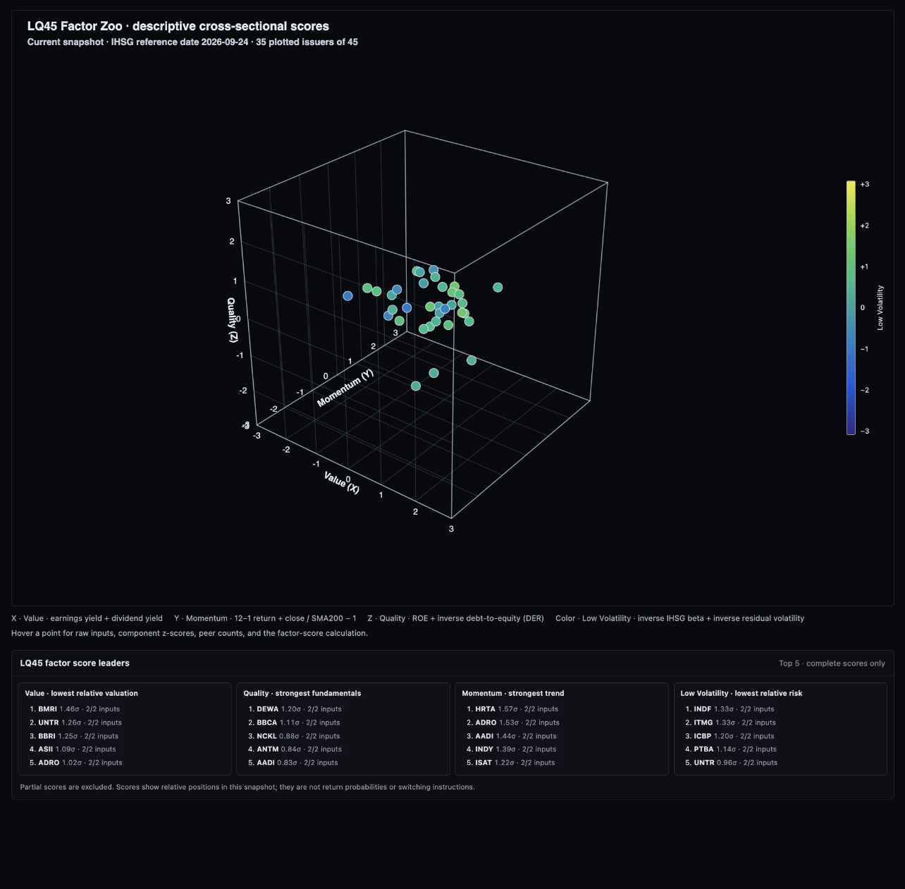

# LQ45 Factor Zoo

A focused, standalone reproduction of the **LQ45 Factor Zoo 3D scatter plot** from [IDX Evidence Lab](https://github.com/rasyaaudreabramantyawijaya/IDX-Evidence-Lab). The project keeps the original visualization's four factor characteristics, point-level evidence, and factor leaderboards in one view. It does not reproduce the Evidence Lab dashboard or other workspaces.

> **Snapshot and interpretation:** this demo reads a compact local snapshot with an IHSG reference date of **2026-09-24** and company-report data dated **2026-09-25**. It does not fetch or refresh market data. Factor scores are relative, descriptive characteristics for the included current-universe snapshot; they are not forecasts, return probabilities, investment recommendations, or evidence of factor performance.



[Open the interactive demo](https://rasyaaudreabramantyawijaya.github.io/LQ45-Factor-Zoo/)

## What the visualization shows

Each plotted point represents one LQ45 issuer. Its 3D position and color encode four cross-sectional factor scores:

- **X — Value:** earnings yield and dividend yield. Higher component values contribute to a higher relative Value score.
- **Y — Momentum:** 12–1-month price return and price relative to the 200-session simple moving average.
- **Z — Quality:** return on equity and inverse debt-to-equity. Financial and non-financial issuers use separate Quality peer groups.
- **Color — Low Volatility:** inverse IHSG beta and inverse residual volatility. The MATLAB-style Parula scale maps higher relative scores toward yellow and lower scores toward purple.

The page opens directly on the 3D visualization without a title bar or control buttons. Drag the plot to rotate it, scroll to zoom, and hover over a point to reveal its ticker, sector, exact factor scores, raw input values, component z-scores, eligible peer counts, reference dates, price coverage, and subsector. The hover also shows how the displayed score is composed, including the direction reversal for debt-to-equity, beta, and residual volatility. A point crosshair projects the selected issuer onto the axes. Use the arrow keys while the chart is focused to rotate the camera; reload the page to restore its initial view. The four leaderboard cards show the five highest **complete** scores for Value, Quality, Momentum, and Low Volatility; partial scores are excluded. Hover the corresponding point to inspect the inputs behind a leaderboard entry.

## Scoring method

The plot reproduces the Factor Zoo's descriptive, cross-sectional scoring method:

1. Score each available component across its eligible peer set. At least five valid peers are required. Value, Momentum, and Low Volatility use eligible issuers in the snapshot; Quality is standardized separately within the financial and non-financial peer groups.
2. Winsorize component values at the 5th and 95th percentiles.
3. Calculate a population z-score and clip it to the range −3 to +3. Reverse the direction for debt-to-equity, beta, and residual volatility so that lower values receive higher relative scores.
4. Combine available component scores using their arithmetic mean. The compact data dump includes every component's raw value, standardized z-score, and eligible peer count, so each displayed factor score can be recomposed and checked. A factor is `AVAILABLE` only when all of its components are available; otherwise it is `PARTIAL` or `UNAVAILABLE`.

Momentum uses the 12–1 return (`close[t−21] / close[t−252] − 1`) and the latest close relative to the simple moving average of the latest 200 closes. Beta and residual volatility are estimated from issuer returns aligned to IHSG returns; at least 126 aligned daily returns are required. Quality component scores are standardized separately within financial and non-financial peer groups.

## Demo data and provenance

[`data/demo-universe.json`](data/demo-universe.json) is a reduced export of the locally available Factor Zoo snapshot for **45 current LQ45 issuers**. It retains issuer names, factor scores, each factor component's raw input, component z-score and eligible peer count, component/factor availability, peer group, reference dates, and daily-coverage metadata required for this visualization. It omits raw daily OHLCV histories, company-report files, and source filesystem paths. The chart has **35 plotted issuers** with all three axis scores available; each leaderboard is ranked only among issuers with a complete score for that factor.

The source artifact marks its universe metadata `PARTIAL` because the universe snapshot hash is missing or mismatched. Coverage also varies by issuer and factor. This demo uses current snapshot membership; it does not reconstruct historical IDX/LQ45 membership, delisted issuers, or point-in-time constituent changes. Missing factor inputs remain missing and are never replaced with zero.

The reduced export was derived from local source artifact fingerprint `007f24fe3c254a7080a2d26b540a163f6b685ae2b02d761ecd4ed636910940af`. The source project remains separate and unchanged. Relevant source implementation and artifact:

- [`portfolio_factors.py`](https://github.com/rasyaaudreabramantyawijaya/IDX-Evidence-Lab/blob/main/src/idx_evidence_lab/portfolio/portfolio_factors.py) — factor inputs, cross-sectional scoring, and coverage rules.
- [`130-portfolio-lab-factor-zoo.js`](https://github.com/rasyaaudreabramantyawijaya/IDX-Evidence-Lab/blob/main/frontend/legacy/scripts/130-portfolio-lab-factor-zoo.js) — source visualization behavior.
- [`portfolio-factor-zoo-data.json`](https://github.com/rasyaaudreabramantyawijaya/IDX-Evidence-Lab/blob/main/docs/prototypes/portfolio-factor-zoo-data.json) — source data artifact.

## MATLAB camera synchronization

The MATLAB app is an optional local camera controller for the web plot. Run the page through a local HTTP server and open it with the query parameter `?follow=matlab` (for example, `http://127.0.0.1:8000/?follow=matlab`), then start `matlab/factor_zoo_camera_sync.m` from MATLAB. Moving its azimuth and elevation sliders updates the browser camera. The handoff file includes the data fingerprint; the browser ignores a view generated for a different snapshot. MATLAB must be installed to use this feature. The hosted static demo does not have access to a local MATLAB session or local camera-state file.

## Run locally

The visualization is static HTML, CSS, JavaScript, and JSON. Python is only used as a local file server; no package installation, API key, database, market-data request, or build step is required.

```bash
git clone https://github.com/rasyaaudreabramantyawijaya/LQ45-Factor-Zoo.git
cd LQ45-Factor-Zoo
python3 -m http.server 8000
```

Open <http://127.0.0.1:8000>. Keep the server running while using the demo. Opening `index.html` through a `file://` URL may prevent the browser from loading the JSON data files.

### Start the MATLAB camera controller

In MATLAB, set the current folder to the repository root, then run:

```matlab
addpath('matlab');
factor_zoo_camera_sync
```

## Project files

- `index.html` — standalone plot, color scale, factor notes, and leaderboard structure.
- `src/factor-zoo.js` — 3D projection, rotation, zoom, hover crosshair, point details, and leaderboard rendering.
- `src/styles.css` — responsive styling for the plot and compact factor score cards.
- `data/demo-universe.json` — reduced, offline LQ45 factor snapshot.
- `data/factor-zoo-view.json` — local browser/MATLAB camera handoff state.
- `matlab/factor_zoo_camera_sync.m` — MATLAB azimuth/elevation controls.
- `assets/factor-zoo-preview.png` — README preview of the standalone demo.

## Boundaries

This repository is a visualization demo, not a live-data service, backtest, portfolio optimizer, or trading system. A valid empirical factor study would require verified point-in-time universe membership, historically available fundamentals, delisted issuers, explicit rebalancing rules, transaction costs, and chronological out-of-sample evaluation. No investment decision should be inferred from the relative positions or leaderboard rankings shown here.
